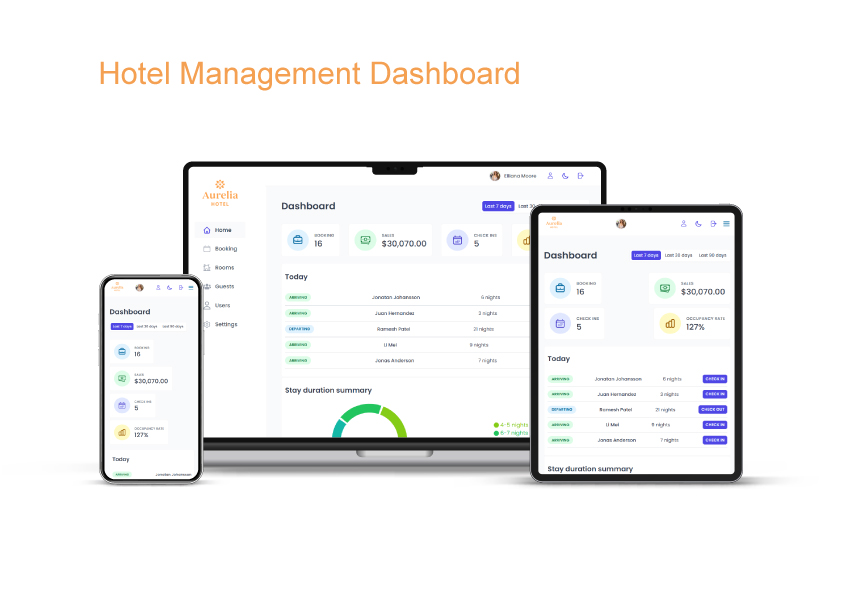

# 📦 Hotel Admin Dashboard

A full-stack hotel management dashboard where hotel staff can manage cabins, bookings, guests, and hotel settings

## 🔗 Link

## 📸 Screenshots



## ✨ Features

- Protected routes & authentication
- Dashboard & booking statistics
- Cabin CRUD & image uploads
- Booking management
- Guest management
- Hotel settings

## 🧠 React Patterns

- React Query / Server State
- Reusable UI Components
- Compound Components
- Protected Routes
- Error Boundaries
- React Hook Form
- Optimistic UI
- Service Layer
- Custom Hooks
- Context API
- Portals

## 🗄️ Technical Architecture

- Hotel staff sign in through Supabase Authentication
- Protected routes restrict access to authenticated users
- React components use React Query and the Supabase client to fetch and modify hotel data
- Supabase PostgreSQL stores cabins, bookings, guests, and hotel settings
- Supabase Storage stores cabin images
- React Query manages cached server data and refreshes relevant queries after mutations
- Recharts visualizes booking and hotel performance data

## 🛠️ Tech Stack

**Frontend**

- TanStack React Query
- Styled Components
- React Hook Form
- React Hot Toast
- React Router
- Recharts
- React
- Vite

**Backend**

- Row Level Security (RLS)
- Supabase Storage
- Supabase Auth
- PostgreSQL
- Supabase

**Authentication**

- NextAuth.js

**Deployment**

- Vercel

## 📁 Folder Structure

```

admin/
├── src/
│   ├── context/
│   ├── features/
│   ├── hooks/
│   ├── pages/
│   ├── services/
│   ├── styles/
│   ├── ui/
│   ├── utils/
│   └── ...
├── node_modules/
├── public/
├── README.md
└── ...

```

## ⚙️ Installation

1. Clone the repository:

   ```bash
   git clone https://github.com/yacineaaddi/Aurelia-Hotel.git
   ```

2. Navigate to the project directory:

   ```bash
   cd Aurelia-Hotel
   cd admin
   ```

3. Install dependencies:

   ```bash
   npm install
   ```

4. Start the application:

   ```bash
   npm run dev
   ```

## 📄 License

This project is licensed under the MIT License - see the [LICENSE](LICENSE) file for details.

## 📬 Contact

Software Engineering Graduate · Frontend / Full-Stack Developer

Yacine Aaddi - [yacineaaddi@gmail.com](mailto:yacineaaddi@gmail.com)
