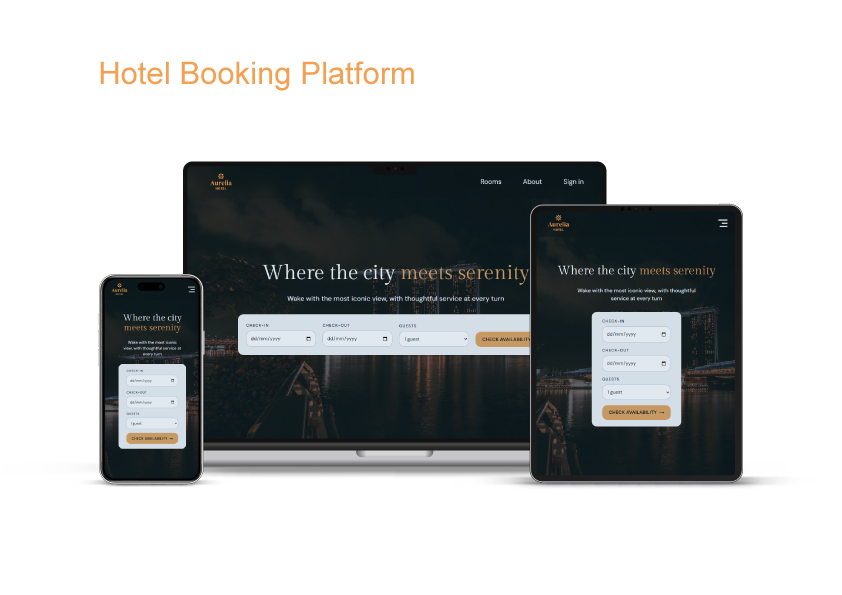

# 📦 Hotel Booking Platform

A full-stack hotel reservation platform where guests can browse cabins and make/manage reservations

## 🔗 Link

## 📸 Screenshots



## ✨ Features

- Create, edit, and cancel reservations
- View cabin details and pricing
- Automatic price calculation
- Check availability
- Breakfast option
- Browse cabins

## 🧠 React Patterns

- Server & Client Components
- Error & Loading Boundaries
- URL State Management
- Dynamic Routing
- Server Actions
- Form Handling
- Optimistic UI
- Custom Hooks
- Context API

## 🗄️ Technical Architecture

- Guests browse available cabins and view their details
- The data service retrieves cabin information and hotel settings from Supabase
- Guests select their reservation dates using the date picker
- NextAuth.js manages authentication and user sessions
- Server Actions handle reservation operations and call the data service
- Supabase stores and retrieves booking and guest data
- Next.js renders the updated pages and reservation information

## 🛠️ Tech Stack

**Frontend**

- Next.js 14
- React 18
- Tailwind CSS
- NextAuth.js
- React Day Picker
- date-fns
- Heroicons

**Backend / BaaS**

- Supabase
- PostgreSQL
- Supabase Authentication

**Authentication**

- NextAuth.js

**Deployment**

- Vercel

## 📁 Folder Structure

```

customer/
├── next/
├── app/
│   ├── _lib/
│   ├── _styles/
│   ├── about/
│   ├── account/
│   ├── api/
│   ├── cabins/
│   ├── components/
│   ├── login/
│   └── ...
├── node_modules/
├── public/
├── README.md
└── ...

```

## ⚙️ Installation

1. Clone the repository:

   ```bash
   git clone https://github.com/yacineaaddi/Aurelia-Hotel.git
   ```

2. Navigate to the project directory:

   ```bash
   cd Aurelia-Hotel
   cd customer
   ```

3. Install dependencies:

   ```bash
   npm install
   ```

4. Start the application:

   ```bash
   npm run dev
   ```

## 📄 License

This project is licensed under the MIT License - see the [LICENSE](LICENSE) file for details.

## 📬 Contact

Software Engineering Graduate · Frontend / Full-Stack Developer

Yacine Aaddi - [yacineaaddi@gmail.com](mailto:yacineaaddi@gmail.com)
