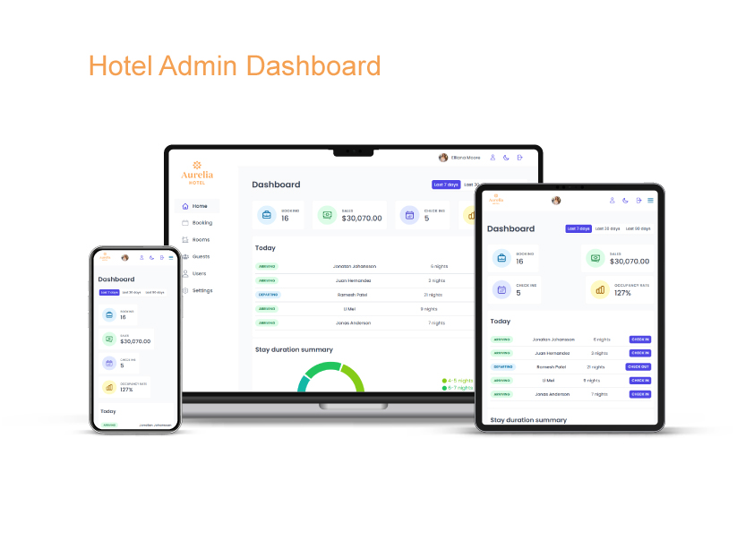

# 📦 Hotel Booking System

A full-stack hotel reservation platform composed of two separate React applications:

- Hotel Admin Dashboard : hotel staff can manage cabins, bookings, guests, and hotel settings

- Hotel reservation platform : guests can browse cabins and make/manage reservations

## 🔗 Links

- Hotel Admin Dashboard :

- Hotel reservation platform :

## 📸 Screenshots



## ✨ Features

**Customer**

- Create, edit, and cancel reservations
- View cabin details and pricing
- Automatic price calculation
- Check availability
- Breakfast option
- Browse cabins

**Admin**

- Protected routes & authentication
- Dashboard & booking statistics
- Cabin CRUD & image uploads
- Booking management
- Guest management
- Hotel settings

## 🧠 React Patterns

- React Query / Server State
- Compound Components
- Protected Routes
- Error Boundaries
- React Hook Form
- Service Layer
- Optimistic UI
- Custom Hooks
- Context API
- Portals

## 🗄️ Technical Architecture

**Customer**

- Guests browse available cabins and view their details
- The data service retrieves cabin information and hotel settings from Supabase
- Guests select their reservation dates using the date picker
- NextAuth.js manages authentication and user sessions
- Server Actions handle reservation operations and call the data service
- Supabase stores and retrieves booking and guest data
- Next.js renders the updated pages and reservation information

**Admin**

- Hotel staff sign in through Supabase Authentication
- Protected routes restrict access to authenticated users
- React components use React Query and the Supabase client to fetch and modify hotel data
- Supabase PostgreSQL stores cabins, bookings, guests, and hotel settings
- Supabase Storage stores cabin images
- React Query manages cached server data and refreshes relevant queries after mutations
- Recharts visualizes booking and hotel performance data

## 🛠️ Tech Stack

**Frontend**

- Styled Components
- React Hot Toast
- React Day Picker
- React Hook Form
- React / Next.js
- React Router
- Tailwind CSS
- React Query
- Heroicons
- date-fns
- Recharts

**Backend**

- Row Level Security
- Supabase Storage
- Supabase Auth
- PostgreSQL
- Supabase

**Authentication:**

- NextAuth.js

**Deployment**

- Vercel

## 📁 Folder Structure

```

Aurelia-hotel/
│ ├── customer/
│ └── admin/
├── LICENSE
├── README.md
└── .gitignore

```

## 📄 License

This project is licensed under the MIT License - see the [LICENSE](LICENSE) file for details.

## 📬 Contact

Software Engineering Graduate · Frontend / Full-Stack Developer

Yacine Aaddi - [yacineaaddi@gmail.com](mailto:yacineaaddi@gmail.com)
